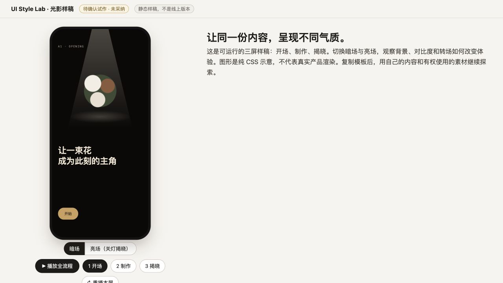

# UI Style Lab

**把“界面不够好看”变成可以比较、解释和迭代的视觉样稿。**

一份中文 Agent Skill，配有无需构建的交互模板和检查工具。源于花艺网页的视觉探索实践，公开版保留可复用方法，移除了个人对话与内部工作记录。

## 它帮助你做什么

- 将结构问题与风格问题分开，减少只换颜色的无效改版。
- 用同一内容和真实产品素材比较不同视觉方向。
- 制作可播放、逐屏、重播的样稿，让转场也能被审阅。
- 记录选择理由和参数，在已有方向上继续收敛。

[Skill 入口](SKILL.md) · [案例与取舍](case-huajian.md) · [验证范围](VALIDATION.md)

## 一分钟试用

```bash
git clone https://github.com/fioluuuna/ui-style-lab.git
cd ui-style-lab
python3 -m http.server 8806 --bind 127.0.0.1
```

打开 [三屏样稿](http://127.0.0.1:8806/templates/starter.html)，尝试明暗变体、逐屏、播放和重播。主体是 CSS 示意图，不是花艺产品的实际渲染；没有外部图片、字体请求或 API Key。



## 让 Agent 使用

让支持本地文件读取的 Agent 阅读仓库根目录 `SKILL.md`，例如：

> 先检查这个产品的现有界面，区分结构问题和风格问题。用同一份内容制作可比较的视觉样稿，保留已认可的功能。这轮只做本地预览。

支持 SKILL.md 自动发现的宿主可将整个仓库放入其 Skill 目录，目录名使用 `ui-style-lab`。不同宿主安装路径不同；本项目不修改你的全局设置，也不绑定 Cursor 专用工具名。

## 文件与依赖

| 文件 | 用途 |
|---|---|
| `templates/` | 三屏 HTML/CSS/JS 示例；现代浏览器，无构建工具 |
| `lab-kit.md` / `transitions.md` | 样稿结构、状态与转场方法 |
| `verify.md` | 检查流程与证据边界 |
| `real-renders.md` | 真实素材与可恢复的 Three.js 试验 |
| `scripts/freeze.js` / `compose.js` | 在开发预览中冻结转场、拼对比图 |
| `scripts/cdpshot.py` | Python 3 解码已有截图 JSON，无浏览器驱动 |
| `scripts/three-hook.js` / `render-helpers.js` | 可选高级脚本，需目标应用提供兼容的 Three.js 场景 |

模板是样稿工具，不是生产 UI 组件库。高级 Three.js 脚本没有在所有框架或版本上验证，具体限制见 [真实素材](real-renders.md)。本仓库不含私有项目源码、模型素材、音频或第三方歌曲地址。

## 来源与使用范围

由 fioluuuna 的界面探索实践整理，AI 辅助归纳与公开版维护。案例来自已有工作笔记，历史效果和数值未在本次发布中重新复现实验；本次实际检查列在 [VALIDATION.md](VALIDATION.md)。

当前公开供阅读和评估，尚未选择开源许可证；公开可见不代表授予额外的复制、修改或再分发许可。需要授权时请联系仓库维护者。
